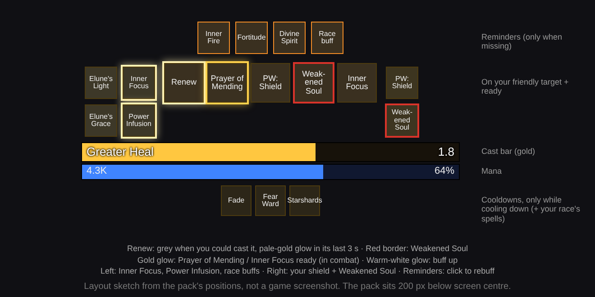

# Forever Auras

Aura packs for **[ForeverAuras](https://www.curseforge.com/wow/addons/foreverauras)**,
the WoW Forever version of WeakAuras.

**Packs:** [Shadow Priest](#shadow-priest-v151) · [Holy Priest](#holy-priest-v100)

> **Status:** Shadow v1.0.0 imported and "works fine" in game (first report,
> 17 Nov 2026). **Everything added since (cast bar, procs, mana bar, glows,
> borders, tick marks, race spells, shield, execute frame, clickable
> reminders) and the whole Holy pack are not tested in game yet.** Please
> report what you see (see [Testing](#testing-in-game) and
> [Testing the holy pack](#testing-the-holy-pack)).

## Shadow Priest (v1.5.1)


**What it shows**, built on the
[WarcraftTavern Forever shadow priest guide](https://www.warcrafttavern.com/forever/guides/shadow-priest/)'s
priority and [Blizzard's Forever priest class deep dive](https://news.blizzard.com/en-us/article/24301514/world-of-warcraft-forever-class-deep-dives-priest-and-warrior):

| Row | Icons | How it behaves |
|---|---|---|
| **Reminders** (top) | Shadowform, Inner Fire, Power Word: Fortitude, Divine Spirit, your race's self-buff (Undead Touch of Weakness, Troll Shadowguard) | Shown only while the buff is **missing**. **Out of combat, click one to cast it on yourself** (Shadowform uses `/cast !Shadowform`, so it can never switch you out). In combat they hide (the game doesn't let addons change clickable things mid-fight), except a non-clickable Shadowform warning. Any Fortitude / Spirit counts (yours or another priest's, single or Prayer). |
| **Procs** (left, 2 × 2) | Spirit Tap, Inner Focus, Elune's Light (or Gnome Eureka!), Elune's Grace | Shown only while up, with a gold glow. Spirit Tap (after a kill) is great while levelling. Elune's Light (Night Elf racial: +10% crit) and Elune's Grace only for Night Elves. |
| **Shield** (right) | Power Word: Shield, Weakened Soul | Your shield with its timer (anyone's shield counts), and under it Weakened Soul (15 s, red border): you can't be shielded again until it ends. Only **your own** Weakened Soul shows (see the limits below). |
| **Rotation** (middle, big) | Shadow Word: Pain, Devouring Plague, Mind Blast, Shadow Word: Death, Vampiric Embrace, Shadow Weaving | **DoTs** (Pain, Plague, Embrace): timer while **your** debuff is on the target; **gold glow** in its last 3 seconds; **grey with a red border** while missing. **Mind Blast / Shadow Word: Death:** grey with a countdown while cooling down, **purple glow** when ready during a fight. **Red frame round Shadow Word: Death** when it's ready and your target is **below 20% health** (the execute window; Early Demise's threshold). **Shadow Weaving:** your stacks on the target, the number turns **gold at 5**. The whole row is hidden while you have no target. |
| **Cast bar** (under the rotation, wider than it) | Whatever you're casting or channelling | Shown only while casting: spell name on the left, time left on the right. While **channelling**, two lines mark Mind Flay's ticks (3 ticks, each hits harder in Forever: don't cut it short). |
| **Mana bar** | Your mana | Thin bar: your mana on the left, shortened by the game (4,300 shows as **4.3K**), the percentage on the right. |
| **Cooldowns** (bottom, small) | Silence, Psychic Scream, Fade, Inner Focus, Vampiric Embrace, plus your race's priest spells | Shown only while cooling down, so the row is empty when everything is ready. Race spells: Human Feedback / Divine Grace, Dwarf Desperate Prayer / Chastise, Night Elf Starshards / Elune's Grace / Elune's Light, Gnome Confounding Flash / Contingency Plan / Eureka!, Undead Dark Sacrifice. Only yours show. |

- **Priests only**, for Shadow or while levelling (it hides for a Holy or
  Discipline spec, where the holy pack shows), and every icon stays hidden
  until you know the spell (so
  it works while levelling: Shadow Word: Death appears at 32, Shadowform when
  you take the talent). Any rank of a spell counts.
- All icons have a thin black border (orange on reminders).
- It sits just below the middle of your screen. Move it with `/fa`
  (unlock and drag the group named **Forever Auras | Shadow Priest**).
- **The game's own cast bar is hidden** while the pack is loaded (the game
  has no setting for it). To bring it back: `/fa`, select the display
  **Cast bar**, **Custom Options** tab, untick **Hide the game's cast bar**.
  Removing the pack also brings it back after a `/reload`.

### How to import

1. Install **ForeverAuras** (CurseForge app or curseforge.com), then log in.
2. Out of combat, type `/fa` and press **Import**.
3. Copy the whole text below (the copy button is at the box's top right) and
   paste it into the import window. Press **Import**.
4. Updating later: paste the new version the same way and choose **Update**
   (not "Import as copy"). It replaces your copy, including anything you moved.
   - **Coming from v1.1.0 or older:** delete the old group in `/fa` first.
     v1.2.0 was renamed and imports as a new group (only this once).

<!-- pack:ShadowPriest start (written by tools/build.lua) -->
```text
!WA:2!T31EWTXX5DFgsXsWjXuu2o2YoXNPLKbvOOebFlB5e8KesGGuGGIuk2g4WDlWDMhU74Dh4lh5uZ2M626K2W0x5rBCzTtA6KK)G1njntRBmBAsMj9XxytBrAtNPvn119)suMPzM2oD6(4WdcskYJI0wCm5me42N3UF7V977B)2VDb3fBu8fA95EitbrBfDnRUYMtrtXs2Bq8x2EtAzlyI)sq1qwWZ1e0eL1nJAkuaLAgdu2HdLmsKelYIEiDfn7SHIKivKKZlOPuqGuJDb3A0LLkAsdK2gxktlKOUMK1sibl0W2MiT82Y32CKqKknOMUgkijJWDeSGGIwu42H3o8oUn4Dc3b0a()9vFmzfkAJBalhv3enjYKpa(1zTmlYbnO9lVlNvqCCjtDJq6Q6MNJd)x2S6Msit5RY(oOtgmAiOQYSZkykXNsxx1wXyrwgQusplWIiIuEKXHgEIIcMi(Ofvv5hvwXg5K9yAwiBplXcmyUC4qh0PGdRmlA)lqOckSwxw8Z5uY71Or8d2M6QQiPqYkQsyQZLn8VIog)hKFyzbj9P4hYubzzJdpKPUinEdftfB(ucggTVzltmnnCUIQlw0YOZnBHIOwud9Ww8XvYlBBCQnDXkAIgx4bD)7Ppm(eTyocWdJyeSf80KIKXX2uvZIkA50nDqJlIFuefzsKMTL8I5n1lAWgAKnUhL8A46ZbWqZsettDtl5RHb2itnb1lIbV4e)kbv1fKIMuuvWY64jlueds8M1srlVkk7qjJfz4ulLJ10sBzGeVB40h34qSesho2WHInu8yjIiVOtu9py8ljpFrluAAnMXObYZ1wdYznWymnBJ391TlVGjkpU9rMgLK23sAjkOI8mVfsnhD(jCWSwOc4kizBT2zRTTGvXSjPLXY7c26ItY6Gh4XE25SnvYNhhmXXnDEmAseHOSqOk4wOHGfXSjGOznufMbzEvs7wqDkHzSSnlIYmFrnNY614qeomtIsXcpGUeYZIskwpvrnA8(fuv9xurAX4rI3rpXhR9EmmmDAoEmNMni9f8Aod7jUNRfGdZBXl4XlSpVlki9ufTSrsdim9TwnGI2Tc73d82GBdoaCqWlHzu9Cto0gZFbAeomCNEnoCwhgdeIFyflsNURLyCohwViMNM8CfeMogEoSLNLTKXdzsozltsrk3dp4)GhWlW7DormZf8qNwMLk)eHFI8YLdn8ukgOmg3z5WPqtBJRnHSyEdzwqczjytyRIKHh2twzezMySGk43DMfiFIBqyK(9Fl4jkqtqZDbNqgEVYqlYWj)kMkAeslkZ1ghHmcqqy2jjtqKHwNeo1XHt7fAd8dTtqUqhYqNYlGZKQ64A4gYbEKpl0fUHrgSrtJ7(PRMMm0TmffunQmqpGVRAyQN3ezzXAwN4(VLBfodKgEupWzXJmpg8(G3)5UBOHLXascNAc6vtkNd3Z0Ivy96WCnnctRG7BzNq6mqr5eTW8x94Wwp9KkwkyAwgOH5jvonYxlyEv9PYSa5ZGmPaZtEMXI3Zq770T2JFYNT3PNLije2rcMNLjHIAIMOistCgsw83jTAItLJDx0QjUIgY6q0hhMobKwQuYkIJJtWA)ZrdsMLoKY0i1fjbhZbytdCjNaqdM42mjMLWe1(k3cZ8C3ZYmHULlLtWYLBjwW0gS58lyQBJrkeeuWedMiIXHTXpMglHuNWxuCufjB5GbWbxGMqvS61OHZHBLs0m9SZZIalLYOHOMkZYFHIcseoY8PsTCL0ic4EGQbjDvZbhjfHR3s0yjtqvYndCWRsdwH)uWaJKAqJgyrszTvvQRrJ1eD5o(kISC3N1ijF00XmmU3kHsZeeK2W5HK2kfqsgnVgzGKsAPz0ekOiM2wgdDLXtdVnJ3Z6LxwioJhC9YGHjsuHWoJBnArwopa3bJ(ug0YOHtHHOJAkym3OopWWfK0GayM1qWp6XHqFtJgeWW0KcAJpmz2xSWwh5apYNBjsKPWcqhhlGkRMaHBlno6uufjmNFju2I5YrhL6ps8HIosCiC2(rcQ2YlZkqufvSiqlVlHvEZezpSS(udQTKf9Raug4g3flPrSq12cYyCOkXxoozOHfyrsyKcrH(UggDhHWkHLfjziMx4CEGZdXVklNrXYhimgWCJhyXSD2rVrYgRJoNDwJgXfnKdlsSufmBm8u9b9KCkcCngmehCbUGZQRxGmx909Ss5gqYBfgE7ugbKQlyez4IEGrZaJvd7E4szGlldFGmWJNbEccpB4jJbPZazySOFO6yrdczGSRp7yq8a9(zWCHbjchxarzYc5wt(QNbZxfYNdKF9obf4(GNIdg3dOIzicfEnaZFgZ23417gMWdyYyObw3fyFiOOhyY9dtbtdZWbZIzgbpn8bZulId(0hH0o(THFh4Z4fEb43fcdla)EEHxeEj4ZMb(C4HA43NmcdF(AgtH)a6Wy4ok0zxHB)8sMtcFbYGg8fzdyFHBf(s3CpCDu3oCDphU331MC86CBVJxp39axHdEgo4dHFb)mWZcZb)SWphRV(Z)SWhg(fGN7bGFr4xc(LXz45Hpc8rPSBHFfo4xLd(yywOW8Whh(1Un4xNd(n4GFtm573kd8jGpj(n8PQdoq7NBr8qb9tpTAHXu7CKZxdEadgUa3n74HJTfWdN6Ti4HtTvXdnhzAnuZNBu)sQ72Wdh3T4Hx(LERaAa3l3Iyb)DmROQ)GDGszvhwOgHfp0kadBJWG7IAWi4ULH3fCpW9YOahbt9VFpW7(GW7z)oOIhCwJhDJmkrsIU4y1aRMerRUZWpKGIMXJ4IshgnjEXuyL64hsviFr0gBwLAkmETXs8bvfSSno7wTfhgjylBe5gQ48OPrIfTrUQNFrHcelDjYhPqwILHm6Dl0gqctIPD4zUetj5BZwb1pVU1ORZmA8Sz8u5EGEXZGFKvmd2RZKIe4jfrXtcIGrArP4((ZudUFGfh5CXV8uJiEzzRriaEQQSVzWW7eh3uuwqlpY6mhFo8c5XltWEg4jsoPGAruMJd)PW(HxzipNU1oXpB0iELjT6V1Ax5o8kNJUK6ojzIUU6260tsrzK44DbH8aVc3CtkyQqmTXs5eidbS1uCC4p5i4QKyLQwBVvYYGHxjd81J2KUrJpkTGn2o8QxJvKKiI1IjdPRn75lvd75)q3YE(7D06yp)12ASNLPSNRZcdBN8Qp22gVACxUmVAZ(dKCa6QcjCSV7SdfpWLIKmd8IlqwbyaQb)QLfEwBbZ8i71IpU(ydKBCD5rl0xOY8XVem0ZFBVjlt)eyO2zii5NaJWQdrd)zWR86)u4R7avHxfwYbyc)5RfEe(gBce4l7we4((QBNiWFe3bV5e1H7Mv0q4VWbVbFtmud(wRqjHV9AbU6oEHjZ2DZOZPfTwW1(QfC9E3zbx1cOoszavzSJh4vxqxRS1kwji64zP8dTorvy23b)49Fl0InNIMOEHSc2WR6pqIWReGjVwaS)OvbWK3adk8aF6njc7mBkECe6D3uwCD63JhxADHNedhEniSX9wMyr2lhQbK59rTruZlNhPHW6aWmff8TMNAoRecfq4ossBI9UGlbnKKgnr6QXHRZG1K8kBCisSROUCmTnB7GOVSZtnTn1utorRJ1vWurcjVi1y34YLxus(A1eGyCo5LRykCYlldDpEOnnIGEM4FJ7CenfB(qYcK9Gf3kSSveTCuj4BphPeK9yzLAgO4FA9ju6A6o6PyTaDUBIa6W3Po8n8xU2qB4Vc))F9Mar)LDlI(Eo8)ZNA7es)J4K2AWy4Vbam)RVlTbTmbwc)Tuf((EYWFxg4Vxg(hKHsYW3xg(hZa)tvbhWpOmqa(NxjcyyrDPcdRn9a9FHAqaTvla4ORC1qCBxd9ZJvtttISdEjdgpcMz0y05692jvXoM6D(XiJJugaSFY4CTsjBgE1LXkrkI0SLPwzMm6tgXVn4jrKH6VYQuZEtpiNTGczxBLPd2NXKmnSOjklBhqKNZ0rpEU6uj)hACKyKD5nhE5epEWI226Awp(O9hlvKEgRNR5uletVt63g3zO4bgyOudgmEGqNpq4WXsf7IrQzmpkvY1kg6QIewKz28KibPzCfMO6OFu58JHIkMyIz7Lo0Jyd9VLqZPVQRTu(J8LFlHQtK(5wx3PIxU)cbkgEkbbRAyO8X2vQxUrdSvmwDZmXRaTU1CrXEn9yNLb(6eEvJgDw6PHHQIOaZbh2y44FS7HJFITbHseOvl3c8m7h(qlgCWuPgCGKX6R)uBnuMLRqzFYBauw2ixq0kB)jg0FIAqz)4ArzV5BeVtSXgJAyzfKQeXfJ0NcNnMbTyrA01MUWJIeghR5Pe)W6fvDSe1X3CL(ns7qnD3kHJoDpYZQhKAhQx07BsYA2mwE)h725JpuDZg)jBXzJVXzf9hARAe9lMRn7EUya7EtOTYnC9M(9t5A78JQ)03ehv)VGpT31JR6lTiZdisH1CvTP2604W1eEqSA0c26MnEw4ZkJh9VAfNTGMCMRhAORELgvSl7ODKfTUB)EVLHdhpRyrlB9ct7PjvDrbvEMRgYFwEIRKKgPnzRSy8YswgV44AtK5GRTsIUp8sHdjyzhuWK)zolFobvlKxwHBnNq)o5GK6zPvtnPPRpoMB5z5RpgDt(N(kEZH)kDl8A4sZROXRyiOyA57P5BAiQ3jsENkA5Xvm1dMBQf(MiVidbP1n96JI)knZlP7LNN1jZsBJP77dqELpboALC04e0KiF36Wi7aAsJyiHx6bX2cKQJKoEvpA4CtZVMUD9Dhw1vnx8RtgolpXllDYImof8GpEvk5kQj6d)AWT)1PbG7A5O(DPUMpIRx1cpzjjn7ut0MfjcA)ynhyinnEsjpZ68g8rhvBMhVqrNAf)e7fuok8lHcsQPBIl4guH1tpcRi1pdPvHuGW5dx3RklBY3dPEQTHs(K8VZqvLM8A1g0uuP5FEj90SPlz2b4IEKjnLq5ekQANjOeYs04sJkROsAvkw8gcIJZJ)M4HYiPwinv(84rTh2INyfnrCVKcrTSfMXI0BKqATYpIMTcUC268zPBOOcjtIJ3Q)XrZCT6MZgKa(mUNY00Y1E5AgAiRTE(8QiZIwOW4Mxg4l65Av9PtM)8rzV0b9Z2PF2nBdIMdxdvZrN9q01VdYh96z(Yj5VQCJ7UehhrEXvrAKnpQptbjfIrfWYpmoCENqdAs(KQq)c9pyYyxEWePcehEYtcPLjYxOUlBn(8480Ww4(xW4rIMAtT9GHk37xTjQU(AMTOE1wxjUBNQOMJKktcZtsDwvEvsldbZXZCv6xblBgg)bchEbAuHQ0jwKgUFQBbFjNa0b7KjICXijxIgdZDjhJR2qxIBzAOYB4jNXHwryYle(iSsKIzwedFvnDsvoMp(iXoz1qNCysbyTsQNKEi49FzQSxhV(L4U7meYKohOK0cMib)ecW6PY1TtfoVqSejIKmnzSA9KsFFxxP0AxpP0K3ZJFl0x0ISx01DHw33MrFao6BYt96d8dNR8jpzzhdoX8wA)XhEGA0v)Iq4Gec7cvmSSL3kQUxNzc9fqiVIVzMS3rdqfWh(iuj8)G9bFjU6nq42NwE)lW)kt7o6Ea0PJkEe16UD80oYeQtTzNqXtzm1MlxUZ)w5v88dH)Dz41wLX(G)d41H)ZAOPtohH)f1dyjB1TgsfcxIZxjUMRqAxIEanCYvM6j0Df1FOP6A8rhFcfkHE)WqQ7JqO3frL9VJtLlX1sjUtUksBjUwxfbTBcbTBcb1Omb9JqPNNAhDfkL4EBRRWPsC325yw9R8UAvI7a1UiMNqUe3bjcFkX5LWm)jFqhrmL4E708vI7DuI7DUPKOmGGMWwsIsjUgQtqsjUdvZqtjUgLRH3BjoE8WYdwIRP1Mn79cx5GuUFL4EO1JP3766Z0Z4ORHpXNvjFATIfYImDIZ4qbYMfttuWkKLGMGfm)8bvYZcSU8NVp4kXVfNw4r3kTWRDmN9IWGylNJDSvinW4uRUTxtUtlHevkiOwR39F0RFjyXLL1Rm8D9ZmvGi9ytMmNQUU5QezuI7yL4oEjUhUMPz5GWjP2LAEALqknx5PA0DKSs0RAw3ejvVqBteUNitAvR8IwEBe5fRW2ajfuvYRHjOvN7zYo1Ni5DEt1TaHeHmjSIBkEYYgU7fAyJp3JL3qzAAy1M1ergNXnfAiRzeLve5hgVqBHcgN2nLnkwPCJUDtjQ94z(OUPGRYh56WvnuesIOZUrpUPuHvMurdXoTMUR1IxOa1sgiCYK1I7UwBizIEMwOn20RRy03wWKCi9KS2y)hS2YTIdL6g79KROHQRLJmJMSgROQcwYUJkHlorDAYjpJ4ZNAUd4ggR6n)WcIMk5u2m(m5A1Nzh4xxnjZ5q)ILkgeRF)uyzte5FnVPRI6eaMuvPGI99UPm49sohGl6zHTgrGbT0nTH7GSAkr0bnXRfMCMu5CHjX9N689EA)c9h7CHiUOrCsBsUStAE)h4nkNVW7642erQA60sCHCTNa9OFOvA90sCPwhZNEIRJrXRHw6SZ3xLTZ3LhAHVl5n529(EYb7t8ct(uMAtix2SLrQZi23mr9d7E)W6RTZq9lX94ykoU2DlfxisUz7sO3Sbu8VBGIhXTu8x8O7GeCCL7w6DS2gOD)XIuO)Eq7gO3rDncV(JU42lchx7ULIpYidL6sJeSB)ZeB3afVpxtXR3fy2EP44A3Tu8qp10dkhQ45tyF(Ddu8(DnfVR(3jP44A3Tu827pyIeTNSO0Ws7gO4XCV3EELDsbN0Q3T08lBnME0lhoOwKX2nqZpN7r5P2rr5PCVSZzB(cnht(sn3HWUbk(53cO8p(olk)J7AAEEHEILnF(zh2(s7gO5XDnk)eNCNeLJRD3sXn9n256YSJ(k22Uc(kd4wkE9Ng6TvcoUYDl9wEcZ(9jloY4ThD3a9oH75Q8m3XokxfC17wAEGHtnnkWuQXsez3anFWTan)U3zP53TRP5(Ije4c(0epxYDfR0FOTG0ZNFNv65Z7AAE4PhU3yHhAMPgzxbV8l4EAE938nBZ0CC17AAE8K(9fEMSn3XUcAEYTan)u7S08t5AA(e2wJnXezNyK(Nz9O53mC)D8yB4nbbQGIMeYSAAKnULVGIf5ga14C3yLN3NIgp7O(2S7Alo7uOIjQsB5SUP848ARyxuQAXd4MI7S3FoxbTLRIiUPksPxuuMxph9CrqUOeRunVp3tuZxKCd(6uboNTIM30vZBKhVIeHkgivIqrkkRwEhKqv3R9Jd)3tV)7Ct5Z1feen1BH6jMXc3cp5o9lwylC2B6uuVZ8bpMvtTW3wND0D7TW)0Sh4VItHl7qW8gMilKMTpItW64r1ks14p1ovRJJqx2vOPoD9z5dLMEGPBTpe7Q8J4DA(uC88xIl0sYwnEI7jpj)GfTjJ5mmpVUM6mTWBPtDTuClPOQnXDwnrcsep8SvEFHei3oY8syGUOT6mNH3zqLoMwTAZIBxJBH7n6248HlaUvQAr6hmpZf)cLqTw2HIXnTqPjheBATqA(074vbBHGZuTJ0e7AUTjMpM3cFto3wIn1Czxc2UOPg1vKR4MZv9Iy(YPZ84Dsu1r6ls9gzkLh3GIPfIstIJ7iKTlZ3kFlSQ0Xr0Phy1ADm(K0R0rVvCXCNCuH0xPeHWKwBe19291e7GVs6FkQT4uzu3iN4x5bOnswwsHkGPf2OMAUMAJ6t1QQ0lYtlFSsVI0jx1Ww2it8iwivf8WJVMcOnZigexTh)qyCN0PcRRFGBNSQOcPK1VPEa56b7yZdCiMSCwx3N2GTTnvWbX9EIhXqAk05rRUNvnJ0mqVErBHnP7mmF3Xh9T0CZvALvlnXfZ18rgjQm)Q5AGatjylkJmx9i4OojGNiUIrk25rOzVRt2pB5A0RZ3NzenthQpEiIDbyJbALtT8idnbFnXUGxsNmsFrsKosIabJhjCtBuUP387Xs0x6rhmz81k7K5xofzKeXsLoWijdqO3oZQQwac9s0uXaNXb1OLaNn2KJM9wzsc8)M5MPZOujUcRZHu6dV(B0(eybilqDSu6uD5vOXM9gPXwnN7(o705AvA90HRY53e)oxJJp2YSTMFah5LB4rjBAZUoFIPf9pPV2R5WdfF)38FwYkXPT1gNkXnvg3n(8J23RVfhokXn9gpg02tPKTR2cGgASCB8yavpI7yBrpcQAeD2tpeLiWFTNke7PcXEQqSNke7PcXnUOjD3kA6BCuMKj5TDjtFJJULfmfv3ySZfvu5IjcUXxCVubtnTTiy6d8(z4GNGjIQn)DWwOl9B)T1zx(3tw1EYQ2tw1EYQ2tw1nUSkd3kR6Lhyhsw1jE5boqQZSLfxzprwRPSJFHyNUZn8ArHkT6O7isR6O7o9tfxXEWF3D1tB7jVAp5v7jVAp5v7jV6gxE1eU2SF9(c7ucSWv9buFWTSeR2lKT7STl4pwFjQrI1iRVeRdT9z4p)DXetr(EpXt7jEApXt7jEApXt34INmDTP)EPDmt)9sBzjt(ngoWy(h2(0(6QgjtF(1xY0H3(Km1wpT1E30vqrEypzt7jBApzt7jBApzt34YMSC9sNI(93PeorQ6TS0PzBwiV)(IiAeADKo1O0o3f22M2lK)KGp4Rb)KsC3rjU3BjUtxIZFjUueY3)30CVWkDIv2V8145EuxyLE9Fs)P9V1Q)M35Bv)od2YQ(XdSLA(fbSL163PVPuWFiOv(3Rp(CMubf1Fnd1sD)(61ClebvIwTSg3u607x2vChO3s1lOu67J2MIINerVG6Si8Ky3kA4mw5kMXhnRZG7o8KwWdBXyjILJtQFhpa(KuMTMvCtyC2XVlSitvNl(utg7y9ALz3QJNbBrfE)io1lTSs6ApSnp5h4E(zq20Rt1Y3MQ4PpZtVXzIjQRz8WvVBmjHTECkB80mQu6Qoao5wUUxx62XBzxowmuX4dj6RTPUSqzxo(5F7nwOrPgTs2wRD0A7no5(UY)p
```
<!-- pack:ShadowPriest end -->

The same text is in [packs/ShadowPriest.txt](packs/ShadowPriest.txt).

### What it can't do (Forever's limits)

Forever hides most combat information from addons. ForeverAuras gets around
this by letting **the game draw** the buff, debuff and cooldown icons, so
those keep working in combat. It means:

- Glows and colours are limited to what the game can draw itself: "running
  out" uses ForeverAuras' native Remaining Time glow. No out-of-range or
  out-of-mana colouring during a fight.
- **Shadow Word: Death can't predict an exact kill.** In combat the game only
  gives addons your target's health as a **percentage**, and the same % means
  very different health on a small mob and an elite. The red frame marks the
  execute window (below 20%); change the number in `/fa` (the display named
  "Shadow Word: Death execute", Conditions tab) if you like.
- **Weakened Soul:** debuffs on you can't be recognised by name in combat, so
  the pack looks for "a debuff you cast on yourself lasting exactly 15
  seconds". A Weakened Soul from **another** priest's shield doesn't show.
- **Clickable reminders work out of combat only.** ForeverAuras marks them
  with a yellow "Secure frame detected" note in `/fa`: that's expected.
- The Mind Flay tick lines show on **any** channel (Mind Control too): in a
  fight the game may hide which spell you're channelling, but not that you
  are. They're fixed at a third and two thirds, which matches Mind Flay's
  3 ticks over 3 seconds.
- Debuffs from other priests don't count (in Forever, Shadow Weaving only
  helps the priest who applied it).

## Testing in game

v1.0.0 "works fine it seems" (17 Nov 2026, one report; items 2–9 not
reported one by one). Please check and report:

1. The import works with no red error in `/fa` (updating: choose **Update**).
2. **Cast bar (v1.1.0):** casting Mind Blast shows the bar filling with the
   name and time; Mind Flay drains from full; the bar disappears when the cast
   ends or is interrupted; **it keeps working in combat**.
3. **v1.3.0, please check each, in and out of combat:**
   - the two tick lines appear on the cast bar only while channelling;
   - the mana bar fills and shows your mana (e.g. 4.3K) and a percentage,
     also in combat;
   - with no target, the whole rotation row is hidden (Mind Blast and
     Shadow Word: Death too, since v1.3.1);
   - a DoT glows gold in its last 3 seconds; a missing DoT has a red border;
   - Mind Blast / Shadow Word: Death glow purple when ready, only in a fight;
   - the Shadow Weaving number turns gold at 5;
   - Spirit Tap (after a kill) and Inner Focus (after using it) show on the
     left with a gold glow;
   - Vampiric Embrace and your race's spells show in the cooldown row while
     cooling down.
4. **v1.5.0:** the game's own cast bar no longer shows when you cast, also
   after `/reload`, zoning, a flight path or a vehicle; unticking the option
   brings it back.
5. **v1.4.0, please check:**
   - click a missing-buff reminder out of combat: it casts the buff on you and
     disappears; clicking where a reminder isn't does nothing;
   - in combat, reminders are gone except Shadowform's (if you leave the form);
   - Power Word: Shield shows with a timer, Weakened Soul under it;
   - the red frame round Shadow Word: Death appears below 20% target health,
     only while it's ready, also in combat;
   - Night Elf: Elune's Light and Elune's Grace show on the left while active.
6. **Out of combat**, with a target dummy or mob targeted: Pain, Plague and
   Embrace are grey before you cast them, bright with a timer after.
7. **In combat**: the same, and the timers keep counting.
8. Mind Blast and Shadow Word: Death go grey with a countdown after casting.
9. Silence, Psychic Scream, Fade and Inner Focus appear under the row only
   while cooling down.
10. Shadow Weaving shows the stack count (1–5) on the target.
11. Remove Inner Fire (right-click it): the reminder appears. Same for
   Shadowform and Fortitude.
12. On a priest that doesn't know a spell yet, its icon stays hidden.
13. On a non-priest, nothing shows.

## Holy Priest (v1.0.0)



The same look and behaviour as the shadow pack, in **gold** instead of
purple, built for healing. Based on the
[WarcraftTavern Forever holy priest guide](https://www.warcrafttavern.com/forever/guides/holy-priest/)
(no fixed rotation: respond to damage; Renew, Power Word: Shield on the tank,
Prayer of Mending as the capstone, Inner Focus with big heals) and
[Blizzard's Forever priest class deep dive](https://news.blizzard.com/en-us/article/24301514/world-of-warcraft-forever-class-deep-dives-priest-and-warrior).

| Row | Icons | How it behaves |
|---|---|---|
| **Reminders** (top) | Inner Fire, Power Word: Fortitude, Divine Spirit, your race's self-buff (Undead Touch of Weakness, Troll Shadowguard) | Only while missing; **click one out of combat** to cast it on yourself. Hidden in combat. |
| **Procs** (left, 2 × 2) | Inner Focus, Power Infusion, Elune's Light (or Gnome Eureka!), Elune's Grace | Only while up, with a warm-white glow. Power Infusion from another priest counts. |
| **Healing row** (middle, big) | Renew, Prayer of Mending, Power Word: Shield, Weakened Soul, Inner Focus | **On your friendly target:** your **Renew** (grey when you could cast it, pale-gold glow in its last 3 seconds), anyone's **Power Word: Shield** (same), and **Weakened Soul** (red border: they can't be shielded yet). These hide without a friendly target. **Prayer of Mending** and **Inner Focus** show without a target: grey with a countdown while cooling down, **gold glow** when ready during a fight. |
| **Shield** (right) | Power Word: Shield, Weakened Soul | On **you**, as in the shadow pack. |
| **Cast bar** | What you're casting | **Gold**, as wide as the shadow one. The game's own cast bar is hidden (same tick box as the shadow pack). |
| **Mana bar** | Your mana | Slightly taller than the shadow one: mana is a healer's main worry. Amount (4.3K) and %. |
| **Cooldowns** (bottom) | Fade, Psychic Scream, Fear Ward, Power Infusion, your race's priest spells | Only while cooling down. |

Left out on purpose: Binding Heal and Surge of Light (in the game files, but
not learnable in Forever), Lightwell (removed in Forever), Spirit of
Redemption (you're dead; the game shows it).

### How to import the holy pack

Same as the shadow pack: `/fa` → **Import**, paste the text below, **Import**
(later: **Update**). It's a separate group, **Forever Auras | Holy Priest**,
so both packs can be installed together.

**Which pack shows:** it follows your talents (your spec is the tree with 21
or more points, ForeverAuras' own rule). **Holy or Discipline: the holy
pack. Shadow, or under 21 points in any tree: the shadow pack.** They're
never on screen together, and switching your dual spec swaps them. Change it
on each group's **Load** tab in `/fa` if you prefer.

<!-- pack:HolyPriest start (written by tools/build.lua) -->
```text
!WA:2!T3vAWXXX1zTCfLix7ebckrtrPync8cGgee3huI2g7fWsUay5UlaiGL0UZUtV7meZoZWzMfGlLPDeIpusCSDGZ9HTcIvoDYpquID54OedR4ehNJNrUGtsLQcDvQCLkvkf(dNeBNJx39SxGae7crirugSkUZ0909R7(1FV3R738MgUMOX0VWjF(JAkM2wrxZQ3uzu0uSK94fVy7jQLTOjEru1qw09nf1slRBg0umhjEbdsQy(IgiWOlXZoIUIMDkFbgnEGOliQPKtKsXEH9eCfP8MSejSXAzArsRRjzTmr0IeZ2KOL1w((NNMIsuVA6AeV0ccpG3CIkAbH3c8wHVV7h((HhaAa))9U2CsjM3g7aReu3KmlXuyqS5SwHN5ygSXLNvsjMEgjtDdF6Q6MN3f(VuP0nLiMY3GF1RtbmAWRQY1UMOPKqCDDvBfJL4fOunDVipJaszjghi2vYlAsecMxvvyszfBItXdPzrSDVmpXyzYGP2VtfJPCnYExKYfu49Uu49zuY6XOr8gBtDvvIKpzfvjK7mTrhvnWeEVcdRRwqiIPcXYgtfXupnn3qAAyzcQNoVLr31wvIOphwMqAzYBH9dJUQTAfqnVg5KwcHvYkBBC6ASs5njZi(41BBmeImjlLHc5qSIOTO7MuKmoAnqKLu0YOB6GcxcVnnjWSenBl5LYAQN3GpLiBCyLSAi1CakSIeW0u30s(MiGMyQjQobcAXh(z9QQlkfmAAvrlRtenxEeC4jLLIwwvsQirdfiw8LZW7yjSmiPpe0(jmoa)bj8hkMVqrchA0ajxYjRHhl8ujxiVfjbJIjnAGEFLuqoLbIT0SnEKBZaErtswS3rfEIYgzrTslQsCVGfrndtQe2FklsoS6r7OT2BR9fTYNkkRowEw0wp9S8H3(ENp382MkzZIjh9eMo3gmkHYsw0xj0k0G38OYbiykdvXceZBq71IQZjwWY2mpbhrAo11JXbO6vMLeNNEeDjI7LKuSUCEnw(DkQQ2zEfPL67cZ5ZFFEv7VR(mD6oUnVkFkQ19BwGFNRNVvWfQrXd42dCVEwsu6Y5TSjsJiE19uoHI2EG96gUp4(H9b7h8qvbTwDihyZ1QancheEqpghmLJ6akR3VIfDq37YC9LX0ZJAYKNpN4vdHsUwUxXsgNWKCkwYOPz6mCJ)dEmpGGN5tJQuK0Ntl5YfVJQfrELIPInNIbjPXdwmDCYvTrQjMc1iKCrjILOnvzkrgoP7uYeQeyiVkyBNCr6VyhcX5p69Gcjqtql9cNsgEhYqRYWP)SMkAuwlj5nNHqmgKIVSJsfpKH2MfoZjG29aDaDcDrXTq3jHEsUiwiv1z0WoY(g4tb9IDm6Kn5Q4Wpr5Njd9jZqbLZkj0p08nmm1ZAsSS4DRt9O3ZEGZcjGN0nCoCM5DcVl4DF2dbnScciP6NPOxnPmo6mtWzErC3EBDf5EBVToz)2EVUDuWMGGCo4rwXjLohIu8HwOow3oQ2tmRILcYbtcnSaTPyz(QEZQQpxYfP)6LBjyb69C18UPT1a9rB8(DVmnF)ogXCVcnvqtYvYt0sxG1Z6HrLWmtzpeJkHv0iwhGDBmM0iRwXLvspd(aR9opljvKnIYvjQlrtEjhuolXuojGgmXUmnNLro8qf7GjHbr5vW7h9eGVVSrdIyNlQO2mXOtaH8BDeC6AzAMXr9NZGAOsPjsf4y5XMLuKqHFjsQ8zYq7gMdhiCKGJhg8NAyIOQT8k8keurf1bA5zz0QTjXoMS(CJPTSf7YGmzyJhI)OXTiv2dsACGs5xmpzOHf5zsLLGGWq3ehtbOOjErKKHqEGZ7gUae(g8sgevrqXgOa5ilnD3n3H90Jp3ugPmAeRQphPeuXcIKX53XChDofjB5qqexWfD59A665yOM(Rw1beDpqS7KQjG49cJldt4gMmjCPkK4HPsctldVNKWtLeEAQyl8mHGejHKCP0JUgPuqmjKcLidU(sKOmikSrfUGmRR805r5jiBgq(B2dOapcCzxWmUbve6d5EvaLlrXDJVzFWvCdMCSly9qG9bG8UHz3lmhCvOGl4AiUdEw49M85p8k8L3veC6KSi8CzEYegC7mlAQBJteuTwEhDSrdyCqB82e4AX0PwItpjDYX7GyYfzpOS(XBYsNbfgKyf65wGNbUEiJgcAQCnHlMxuIUcaH4XxP0ZOlL6XkNKbLhB84u7SlZYLAuqjtby)3GLSKnrVdoE8XmAGNPSOurbF667mASISloWRkZIdFENK(tth3W4HlLkbFPhjmCUjQTsoIKrlRtbOpjHubnXCkPtylJQlLrq99B823OYYt5Y4X3OcyyssRqnH6AD6rwo3apaN)uu1iNhohQiCstrJ5N05gU6h6ZQuHdC9JSVtggEFW7h(b9aphmp4h(HGpGh4dcFi4dNeEEush(HPc4WpsfI0Wpktk2W4Yxq0y6(VYada)yuzw4JYLx)m7b(y3DlTESnqADdSFcPp8bh4TrLzLO2ibsY3iLCHpUl4h3fSa2aFc4Na(jHFk4NMpw)zEo4Nf(5GF(hd(fGFr4tIf4tbVa8lXa)WIUGFzxWNgb0Wlc)kWV69d)AUGFDxWVbY((ntcFg43cBHF71ahyJZTiEiej2iXd1)LSJELkWdiy4IUUBhpC8TaE4mFpcE4mBv8WSt3sxtm7LgyI4DTtdpCI6fp8sV43lGgWr5welKBctZ45chiyKMxdwOcJfhTkWWDqyWdXCueCiz4TbhgEyoh4ii3)rDd)a7hE771bv84tVzUbHUOACz44DrjAK5mgOwlEet6ESf0Zimcb3bUwwJZwZvL5DhQL8ZketwHOkz0tTw3jjIZGDujbCRBQBMtBkxTk8bfkBqDvZXRPQUwXMnD5VdGciprvciECWCJIyUGiglaorgKbRgozfWQrwk2ytLV7yrBoQAwkEITrH3m0NCQtyMwwullX6uNyECNY4kxTlapD0zfvZtsEc43h2l8fOBaTNOPLjPNPxWNB4l4A(zfnvO(dy5mIuEkFxyNa(8hbRc11oT1vB0TlcFHKWFqWM0nA8jzvSXUGx(M8QeLqDSkLTV(A0MQcnA)o1TgT9TgnAFUTMgnzMgnNnI3dLp0R77KA3o(RBTBFYIA323TOD7qPIeEWPcenj8bxKUz5bzUhRs1DPSfnZsS568qcLb8B8GJRPyl4twK6oEIPcUZL0wliRJxvvSlmFguQrtsTGdY(vwH6ZLspo580KuxZL8wuJgrk(CXJyoDxYHlQgDkiYB9(Q0K67y7veOmSNdvHNMHq5OA3WlVOUwXTZxSe)rSsCIum4V1PCeaGxg(Q4Tp69WQ28kAP1ZLc3qZl35GJ6VAeT86HOFPBbrlVjRz7(E8VunIPpBTJP7VBMNTQzmDfQ3EveR8WfzwuVDZCYMqZmNO0Ykzrf3MkP5(Qb(slW83ZOI5i0bsuBQhHGPGgIYYNQH04GRXRE0clBCaAUvrmh))X9yoR1UaZ)FmNX4KToQS3urIiVeZJGy9YMws(MvKGUBs5vk5VqAJXDdoRRvTYAlVHc2JvgdlPrQe46(n51csbXNQiiUsv1fb0uu6Fy1441Olg(I1G23F36v77rVtQ891CD)3DQX9OR7Yj)svTCYxPsvRWFm8LH)KI6nH)0KWx5wvsEbJRLFYlyeURUsxbwZ1DPB7OsyYV32fmPK(SZZuzXmd3j92o6X9TGBEJfdSVJ8bkHcmhEWOJW8E96V1I6hlyyRpDgJix07fNOcSG4Dr2lHV6Amtc)5RVfs4Va))Fznyy8ZwVgg5VtO7y2fFnx9V1mgc)vaGs)FnA)zfQPn4VMTW))gz4Vnj83jd)9YWQYWxxg(hsc)JvBG5csIPJFbXz8nuUkMO)Ivor)M)2lp1MTFr(27w)981Dnw1Q2YNZU3owTu33i38w8C(7Xm(OrKgzc2M3o2(FtA3B1I3G(xE9Qw(BSfeNEJ1ZohDR6yNmbsNjsMHcymypv)saUR3hF3yBFw91C9bEtCA9Bbx3t5z1)zNn0clNKoXUe)TYgx3wuTPo6X4GvKEmdIPOTUzJNd(WY40)nk9cGzpo5TdoCLw6CWyxjqZtAvydFNqduepG7imVLTEUR6Ujv90IQc8iGr4Cc0xVDcI2STXZXd)XY42rQ8H8OTQnA2dHB(WNOLTxrtH335eYiQAr8WRCBzeh2Pe0NEogzQ4z66ZGklpNWAZr3u4zVUNm4LeTkOH1wqrtqXquX0Q5NvOPiSGMH2MkAzrcZcNUMAvOjAdzikTHpFTzjC9weK09iiWhKPy9Xed9EOn5tJzRKHLNOMe9ABXi2dQjnUHKOnHUBok5Op3wMOHLMvEnD71oC4KRCPe2GcCobAW)4uez8j4KFEtsM8APBgBgS)VbDaCOLHfoq6AntF7STkq3MylouI1TOzWghR7edTRjqR5z3GwOz2SAlcenjhQI3XBGIzHncdKuXWeR4MqW1Yp8RinmhPvIvqWYH0(wksn2ou6uzhL(l9)otvL6YRxFqtrLv(fK0tWfxsUnOg9iZAkrYiMx1oPxjIvAJPMuwrL2RuSemWTZlGxPHnhrQvAxviloRDslbQJlsJJsge1YwSGfD0ir0AtyCnBfSE26cPmPEvwHwO0Z0wNZqkCZ1iZ6Lc(moCrEArQxKYqdPS1ZMvLyM3I4h7EjHpQ7BwouJ4VYFM6Lby)2h73o5B2zEKcvenq91pFHPUxOy(Dw2QXHG)dQXIBq0OUMDitrjfIMn14HXbZ6KAmQ77Szbr0Idpw0qtp2OXhmm8mNgsitnUWIGRkcjIfyPTWXM3WbcgNUEStC7xpMVIJ7BDH83(fLTKE5(g8DylrZXgLjvRjLKLTuf1Yq0CMK3GDXRkcYOb2xNd63)ISS8vAeSel9WSWuBkNeSz5OJgyIarxMLdpukUKRktnLRvyPIQZ7tUmoqvPPni8c8Aqd2eutJrZHOHRzgX0KNQSQYNA8qNUCQthJwbEVKfLjhaE3tZS66efA0GVKdnM1jSMtiAse7KYa2OfB9wywLxm0OJgiAc6e1gzE(rUTMN1UDMNPTZtDpSgAjEdfn0qdVfBjNfc4I1sUxtlzAZzNZxmkOxXjdEm81z4yJuXA1Na87LYExSKN8S8uAP7FLQx6E(q91R38tioC2Xz239FeMb()P7f(yUE(ZS9UwVV1gkKd)NNNlwt)TNorM4)vLRfex)3)nBjGFBuS4zoUJKk8D5L5)b(FRbPYre1e3ssLR66EQwyCvC3ILLdx11EKRa)UQRgMDvxhyvxnU(q1hg(47NHGw11b3iGZdF7boghBDI5OukztOLpxkIPtEghyWuPqgIcAnBu2dSGxCbVkz5j2qm(JaF8W3Jtp8b3k9WBECCfOPPXlnDxWh)4vjrzCMBTVxrPtirsRKtuTYON6y3(AWZlfFuz08TVWmLkSpaIOzu11nxZGFvxp0QUo0QUEBR66WviFLb8hLTL(fyuHwDxfLVyEqVu2jxR42itLn4LhP9rthDKkf3EY7JkUv1wRIkQQKvd5OLf4m5Fahe5TFFCSiLhrmPrUxtHJw0JhFBJ22etDoV(d6tcIlVWO)AV8rSkKwwjTqmC7jI52S3UDvTebxUYKOwX6Q5Q(RSOZ6P5is0vRy0BTxh)kZQOr4F4eBwScuv9iwS9VrCc5G6PF6tMAI1ISz(AQY6eZw0KgT8swg9v71QQVleJNOo6I4E(OIG0vuguv0sUE4nyLPRGGgV3c4(Z0QNzF)4AneIjM2ujJc2L3cJv(3zth1rf5FRnOzlV4IzMd(ouJuNSgR)ASsfvvjNI9dxto1BzNWyL9vOuHHkVw6M2Wdqx3yAY(nXL7t)AqCvhU9l3qsxrkN9WT3Ic9TChM2NKlg9gp5(EJYx8E2aVOhOS7Hw11PRx3O)Ppw1oiAvxNBd8q0PUn(97wDj(n4HPFXzw4RHnu96E8UZFToVA3Hhr3OKFzcSg30D3eVVT6(vy8yF(ThM)QUcaFnk1Rxo(CQ9RhBUHvIgyMDcC8Zu3C8d)NTDYXrQxVC82VwFJgU9WYdp3q7e44Tx3C8tgE7KJJuVE54I9nreCvNHc03v2jWX7OU549o82jhhPE9YX1IRnqaTzceNC1DcC8oR7y06GxF7uroJ81lp)YZ0NVHU8Sx4AnNzNapVR6hLhFBfLhV(xTs)DNot3ZnZ0g53jWX7ElGY)eBVO8prDZZ9PoE3D7BKqZfl7obEEp1nk)uNE7eLJuVE54J2Yf0VWOerTS7i0R0B9YXx73eZDugos86LF7FQ5AFe)Dik5xDNa)UV6xRY77b2w1QGKVE55t2BHyDm5L6DWlUJyxq9Vf45hA7LNFO6MNNpBVxAI8(hCU07i45dSfSE(r2ETE(rQBE(0KZpD(P1cokzhHU8Zw)881(9pFhMNJKVU55Yx6YJoTA(Uc4FNap)j2c88ZS9YZptDZZhXMmEKr6oL)HiBep)UHVIZN827K8OKCkAseZkoUTumjc5uSONcuB2RJOYAJL0wXoVu5k)UQ9k78kEIzOyQyxIa(QDcexpFAz63uknMFPNhnLiY5QDIeJDsyKnp9KsZP6orn8jRrI8gzGdpG(0X6BGXdmY57Q47nGu(1GEc4F9Q79bQPGjmNyAt9wzHyui)TkqpaDc53clEtNHf2rh3QPwf6P)(Bv4zPxeUUt9kgKBcgMelIMDZ0a7YjkbvKQigbDOOtW9vm8(ybs45e8LG9zx12qe(rMdnKlAwXjA2OHfgTyveDzN(0cJL3MovZ)k5e01ul0QGLolCPWEsEvBAiAzseLOrUuBcn7tKE8ZjiHi702QfoRGZSjBYSmztH9RzSWrJUnwoScyVu1Ioo4rBg2GsK2kgKCyxZxc6N3iJk0Up740s0w0BHYdKM4NOynXJBYwfAY5ujQPwkgMB25n1yHxxPq3RCKXju858O4KM1Ay95zryhJZJDOqA(y8KW4aH(csAU6wHtsNGRmVTndtukq7IYo6K8ukSjDkrjwFPA4dzT2ewiB2CtEz5shFkQT6qmwOrsJvYbzDsErItYH8cBstTub1yXjOQk78RXQzETR650t1nlBIjoJ5tvbNEAUPb1kmUbn8rXB8JdshcUMXb2p5KOeRKpUzH1Zgb74IaomtEjxZWN1HTTnvWK4ONgNc0Ucte6whzLliRaStvNw5YBNLhsfnZALwAPuVSCTPHnPwZ0zIsYxTubeyor70YeZBDgCsNhGcIvntXJX2w8Sbf)CfPOhNRNDCnthUpofXpPbrGwXNwCMH9GMBI)1bNiAGHcmAIaJoO3Wb830MvA2rRzOrhkXKJfn86vCQ8LtvgF0qXtm44rhKYVDKQkxbk)kTPIbwWX0y1algx4OfpLesG)TK3nf49R6A8niY7)qB0kHEf6BwDr2jSitsxUQ1en9MTMOZ78TNtJmSE2OV6T18brGn568frSc)vXoIJzYn9RJOJrh2BlDmqg9utur4W)Dx)p7vMXRMUJy8698U5yLNMBgRJo7UlQDm(1o7ONE7Cx7z7ApBx7z7ApBx7zV(TNnr9Ap7LgbTNTQRNUoTJ9A3BGnXS1PEPr2x8ZUEwUw11ZS5MRIei2iYreh0BxHRWC1t5AJnxDSTfZvD3xpDYSxXVPZ(6T)o21G1UgS21G1UgS21G1RFdwtwVgS23aVW2LflK07t9X3YMS0KVyZdOjnvGoTRWK17yJTyDG7CEhSZE5MPOx3180UMN2180UMN2180RFZtxQU9p4lUnzD6iVYlULTmLRZlEXc5UAU5gAKkSm9(3ylth8oNLPo6VJU6JTdk6n7ABAxBt7ABAxBt7AB61VTPPQ7Tof8RVDzCIs6TS1PabAFUCgbshwzdSo1O0ZFS30dLNRbndFo4Ba)FR66rx115O8T)9R6sU6atrMgwkg8WsHDw1W(ZJwBcJPjuqpVPqXZBzb(z18z55Yoa3BDDoP9yhrrvDk69e36X3oRqvCmPZSEv4j4KMkLAXkHfJITkikKvxvQ0bAdnJCohNeOT8sFZVnpNITmNg0pm6tAX1PHgIPeZj6ContBPzPq4blosy0MNQZ5TJjxFQELgDBZjUDSywFFch6YQRKU2jTfO)5(sOaXMDk(u8q8bX)lW(kGP)zrZqO8jZc7ptApftpCcAubLGXnPhRAduNrd0wosGkmZuNpAHcIxlCSIrc0h5T2yUgLA0kAhT1DBD14S371))d
```
<!-- pack:HolyPriest end -->

The same text is in [packs/HolyPriest.txt](packs/HolyPriest.txt).

### What the holy pack can't do

- It tracks your **target** only. Healers often heal by hovering over party
  or raid frames; ForeverAuras could show Renew / shields **on those frames**
  instead, but that's a bigger build (ask if you want it).
- A Weakened Soul **on you** from another priest's shield doesn't show (same
  limit as the shadow pack); on your target, anyone's shows.

### Testing the holy pack

Not tested in game yet. Please check, in and out of combat:

1. The import works with no red error in `/fa`.
2. Target a friendly player: Renew, Shield and Weakened Soul icons appear;
   an enemy target or no target hides them.
3. Your Renew on them: bright with a timer, pale-gold glow in its last 3 s.
4. Shield someone: their shield and Weakened Soul (red border) show.
5. Prayer of Mending and Inner Focus: grey with a countdown after use, gold
   glow when ready during a fight.
6. Inner Focus and Power Infusion show on the left while active.
7. The gold cast bar and the mana bar (amount + %) work in combat; the game's
   own cast bar stays hidden.
8. Fade, Fear Ward and your race's spells show in the bottom row while cooling
   down.
9. Click a missing-buff reminder out of combat: it casts the buff on you.

## For developers

- `tools/build.lua` builds every pack (the shadow pack in it, the holy pack in
  `tools/holy.lua`, both from the same building blocks) and writes
  `packs/*.txt` and the copies above: `lua5.1 tools/build.lua` (`--check` fails
  if any is out of date). `node tools/layout.js` redraws the pictures.
- Tests: `busted --lua=lua5.1` and `luacheck .`. They check the structure and
  the rules from ForeverAuras 1.4.3's own `Display.Validate`, read from its
  source.
- `tests/fa-check.lua` runs ForeverAuras' real validation code on the pack
  (needs a ForeverAuras source folder; see the file). Not run in CI.
- **Spell IDs come only from Forever's data** (wago.tools, product `wowf`,
  build 1.60.1.70938), cross-checked with ForeverAuras' rank tables and the
  guide. Never Retail or Classic data.

## Credits

- [ForeverAuras](https://github.com/neroxrw/foreverauras) by Neroxrw (GPL v2),
  a modified WeakAuras: the import format and rules were read from its source.
  No code is copied.
- [Forever Aura HUD](https://github.com/tomqwu/wow_forever_weakaura) (GPL v2):
  read as a working example of ForeverAuras displays. No code is copied.
- [WarcraftTavern Forever shadow priest guide](https://www.warcrafttavern.com/forever/guides/shadow-priest/):
  the rotation priority; [holy priest guide](https://www.warcrafttavern.com/forever/guides/holy-priest/):
  the holy pack's focus.
- [Blizzard's Forever priest class deep dive](https://news.blizzard.com/en-us/article/24301514/world-of-warcraft-forever-class-deep-dives-priest-and-warrior):
  Shadow Weaving, Vampiric Embrace and the race spells.
- Spell data: [wago.tools](https://wago.tools) (WoW Forever client tables).
- Bundled libraries (only for building the string): LibStub (public domain),
  LibSerialize (MIT), LibDeflate (zlib); licences in `vendor/`.
