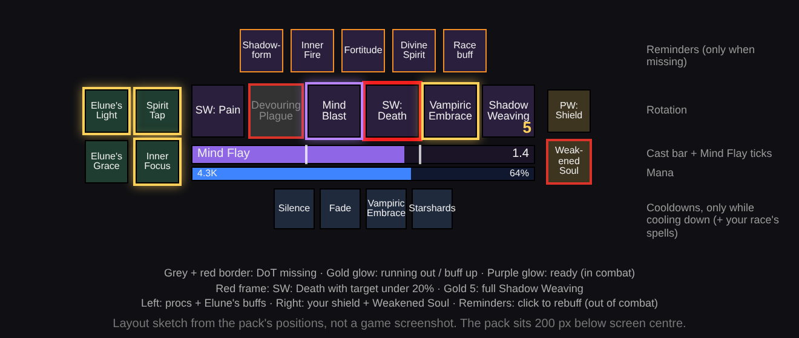

# Forever Auras

Aura packs for **[ForeverAuras](https://www.curseforge.com/wow/addons/foreverauras)**,
the WoW Forever version of WeakAuras.

> **Status:** v1.0.0 imported and "works fine" in game (first report,
> 17 Nov 2026). **Everything added since (cast bar, procs, mana bar, glows,
> borders, tick marks, race spells, shield, execute frame, clickable
> reminders) is not tested in game yet.** Please report what you see (see
> [Testing](#testing-in-game)).

## Shadow Priest (v1.4.0)



**What it shows**, built on the
[WarcraftTavern Forever shadow priest guide](https://www.warcrafttavern.com/forever/guides/shadow-priest/)'s
priority and [Blizzard's Forever priest class deep dive](https://news.blizzard.com/en-us/article/24301514/world-of-warcraft-forever-class-deep-dives-priest-and-warrior):

| Row | Icons | How it behaves |
|---|---|---|
| **Reminders** (top) | Shadowform, Inner Fire, Power Word: Fortitude, Divine Spirit, your race's self-buff (Undead Touch of Weakness, Troll Shadowguard) | Shown only while the buff is **missing**. **Out of combat, click one to cast it on yourself** (Shadowform uses `/cast !Shadowform`, so it can never switch you out). In combat they hide (the game doesn't let addons change clickable things mid-fight), except a non-clickable Shadowform warning. Any Fortitude / Spirit counts (yours or another priest's, single or Prayer). |
| **Procs** (left, 2 × 2) | Spirit Tap, Inner Focus, Elune's Light, Elune's Grace | Shown only while up, with a gold glow. Spirit Tap (after a kill) is great while levelling. Elune's Light (Night Elf racial: +10% crit) and Elune's Grace only for Night Elves. |
| **Shield** (right) | Power Word: Shield, Weakened Soul | Your shield with its timer (anyone's shield counts), and under it Weakened Soul (15 s, red border): you can't be shielded again until it ends. Only **your own** Weakened Soul shows (see the limits below). |
| **Rotation** (middle, big) | Shadow Word: Pain, Devouring Plague, Mind Blast, Shadow Word: Death, Vampiric Embrace, Shadow Weaving | **DoTs** (Pain, Plague, Embrace): timer while **your** debuff is on the target; **gold glow** in its last 3 seconds; **grey with a red border** while missing. **Mind Blast / Shadow Word: Death:** grey with a countdown while cooling down, **purple glow** when ready during a fight. **Red frame round Shadow Word: Death** when it's ready and your target is **below 20% health** (the execute window; Early Demise's threshold). **Shadow Weaving:** your stacks on the target, the number turns **gold at 5**. The whole row is hidden while you have no target. |
| **Cast bar** (under the rotation) | Whatever you're casting or channelling | Shown only while casting: spell name on the left, time left on the right. While **channelling**, two lines mark Mind Flay's ticks (3 ticks, each hits harder in Forever: don't cut it short). |
| **Mana bar** | Your mana | Thin bar: your mana on the left, shortened by the game (4,300 shows as **4.3K**), the percentage on the right. |
| **Cooldowns** (bottom, small) | Silence, Psychic Scream, Fade, Inner Focus, Vampiric Embrace, plus your race's priest spells | Shown only while cooling down, so the row is empty when everything is ready. Race spells: Human Feedback / Divine Grace, Dwarf Desperate Prayer / Chastise, Night Elf Starshards / Elune's Grace / Elune's Light, Gnome Confounding Flash / Contingency Plan, Undead Dark Sacrifice. Only yours show. |

- **Priests only**, and every icon stays hidden until you know the spell (so
  it works while levelling: Shadow Word: Death appears at 32, Shadowform when
  you take the talent). Any rank of a spell counts.
- All icons have a thin black border (orange on reminders).
- It sits just below the middle of your screen. Move it with `/fa`
  (unlock and drag the group named **Forever Auras | Shadow Priest**).
- The game's own cast bar still shows as well. The pack doesn't hide it.

### How to import

1. Install **ForeverAuras** (CurseForge app or curseforge.com), then log in.
2. Out of combat, type `/fa` and press **Import**.
3. Copy the whole text below (the copy button is at the box's top right) and
   paste it into the import window. Press **Import**.
4. Updating later: paste the new version the same way and choose **Update**
   (not "Import as copy"). It replaces your copy, including anything you moved.
   - **Coming from v1.1.0 or older:** delete the old group in `/fa` first.
     v1.2.0 was renamed and imports as a new group (only this once).

<!-- pack:ShadowPriest start (written by tools/build.lua) -->
```text
!WA:2!T31cWTXX5zddPkjK0ijkBhBzN4Z0s0Kku0IGVLSScajGiKabPaaLOuSdWH7wG7mpC3P7oWxjoPM9LBRBAdtBtZJ24Wg300j9fRNe34(iHtsA67)Y(ITDAAR6mz8mTzMunTPnj91)U7Hx8HianzSyk5me4292DVD)F9T7)(Fl8C5gKE(wF2h2suYr1q3U7mzv1vTv8fe)YXxCBhrl8lrntfrV3uuxsXWkSLyEsYPnjzs0F8qHITap7rmu1DY0FOyjdfForD18I0wSB4odVKCblwIuoyTSSjsg6Y2lseTjjCSi65Cu23S0u0gnOUHojiTGWbdMxuvpm86Gxp8DVp4naheoe()Ewzozel4GDGLcByrMGyjeaFC2lXZCyt24Y3szeLgx2YWSFdndRl4b)ltgdlzILYn4Fh0TaMhkOM6mZiAjlK0WqZr1CbEbkvtVZZZiKCoI5HtC9cIweHWf00eUIIQdXT4r0TjoExKNy4SzXuhWTIjuNHS35PubvEVldEDw1C(mBaVWXYqtJi3VIQMmsDUGP)QgycVtHekIYgtkmILkX2btpILHelFtvlvhHKIMMDuR1jIUowQWgsfSn7QwRuiTc6KhXwiQAofN6VANhf3ilKLkhHcaIoIEBuv2841uZSGQEwdlxHRfWlLiHMGO7yRSqolJcMCkTI59QMthBpx(pRiHSSmSSvUjkNsS0f1UmklI38thuZquUP4sAI22nfpFbKN7lJTQEonsMrIhjuIKZvWMKID)0zmrUTUJ5B6w2BN3IKdBAQaDCw3kUTKOgX7C2eTSmnf4azSj5XgiE7T1zBNAE7czIZQJTV5DmKMG332)J)mZ6yPMlhMmwtwUxgooHoEMV)ssqWHcwavyHazm1eNMyDdAhwuBsXPTDSkqspxbD366Z8WuD9jij5PhYqM4Dbzv7NQGolF)IAA(lOkVq0qr7S3OJ1rVMMwUDhVwtXPVFsFwtZVYZZ2k4b1Y9bE9b7X3cIYpvbBhI8qItDNLtOQFNWE9cFxW(G9dha8rnlSs96dVXA6qdWrG7YN5rY4QIsj(dOAth0DVi3gwcJcO1fLzZloveuBY27s2kilt2TyPJlX0J9I)bpOpqW3SsOAoY60tVyXROA2klvmvIjvnjPnVRIPtsMYbBnXmOwA65Lj2IoudCefOjVzuiuDIibvXND65PFIDiui9bUdughAeAUBOff4ekWBrbA9tBPQtjTK03CCcXmGTjrYjov2wbo5LH2AcEuFWPG2NhVHM2464dF)N5Nh8JDgkdMmfoKtv(Ekm2E50PHoGh5gMwg5Si228(XjEG74oHUGRb94f6fzf9bNgoZfUh4qlHsGuJKuXvD5SUgUsjvYQNRDTueK4a3)sUPm4sbfVPnAAZRRf1utOARIeP0WHMJ24Sm)kbZPzmz65PFgKBaEo61CRREhzpNQTE9t)SJU8Ui9gd4cE4DjAQWwKRxGOlnnTi(7I1mrzqi3nRzIQQtSpm7YemnowTsQOknoEd79olljvTCe1PiAlqtoMRKmlXvDtahYc7Z0CwejQNVypm9ZEVlXX7kwl3KfR3I8KPm5k5ZBz4GIgurMGXgowiZJ4GxMcbNmO2WKUIQSJsWayY5z3OSW5nzPZI9szwHEM54zGaeMhkSL6mcxQGOm16PqYKlv6EuSLhSCs6q1A4rtgnsSqlYYLQrQMDA4a3GLSKbPGbgn5WMhINjZwwzapZgQi7Id8QYS4WN3jPF04XnnVVsPsXnANY09I4oQ5jYMTSgfGENuYtRlMxvkLJck6QG6D7Z8nVELLNYJ5dTEfW0IiPsTF5zn6r2UxahKtFkk0YPHtIIOxXs0C2R4EbxUGEp4XqRZWzFpnbp(x08qIOyACr9Xtq1(ImG9r3)z(4lsZmjc2nocMKrxKAELLhtfvvgn1ltYuiBwgxAWqrhj8OrHZLzqIOMJYs8kewvdHRS9TioVjlItcfJjhwFrB2xbywSnVB(Tg1MuzpiT5HlLFX8uGdnpptQLtiae8MO0DiQDeErKvGb8bH8cHHZFdEjdJacuddO53bxitxD2xOmr6SRzMXSbSQ97AteHrq7wOQ(f8gFsQ4Ae4IEGOEcoJHrEQU6P6TAGcyO7eITvckad3nmIcCjVq80qIkSVdjtdJQaxonCL0WyuJ0WvJaxln8242KF4vytgEI0WtwT9x4TV)((iOzxiLcKMzvfextdPNgnKczYcsVs7GmC)aXdK1lKdTackFfqnn8ukW4VshGMxip3cgOF3GXHbtVW13lyb2aA6PaA9bMaMmDLIyW7)O0oXpn8bGpOp4dbFy4CWpd8Z6d(iWZdF00W8iVf(5OSu4JvbteEbgFBGoZ3v3d0XfLTMa(4uUe8lW5qFY7e(e3EZFowTWFU3J03BSwyqxyRLb9S3lmLhyApWm4d4DaVt4PH3f8U5dUVNNbEgyw479bHVp47h(bWc8dcpl8dXmOc)WEGFepWZHgjHFu49a)y7d(X9aVxpWCi969Lg(jGFs8j8tTc(pBqUjfaYBCQP0YpMwxJEXkeaqUFup3UlaC8Ara4fFHVJN9JdXnjZ3FNZiP5pyNKK2RG5xH6)dxf3FlKVF3SLBd3Jc8gH7fUpof4Oi1)b8cVPdaV596kg8qZy(yB0AaJtNofIKx(wuG5tlmIOQU5zQJApazcC(WiUSWiAI5kq24vXwrLX1ZileexpOJ5z3S94biI4Yud9QQ6cKPisfCi11i)YI5P(jqsiu(m0fIB23MOpqeNaPDOQkDL7nxRnWkvKpztvOc7NQ42jQY2DvQS(C1cIHAbHrP(3kkAfGjO3F6ke0hCHrVq0Rn5OsxtXEuQeoB6hVwys7enzjPiQNJyF6MMfx8fo1oNPHXIpHOgUs8MGpnSx4LgX7PARl8AZgWzt2M)2QC1wWlDb2YG6Iwi2AHAVlVXLuisJ3n84EHxYZStiAPsx)5IzfP0C(8aBc(uhfBsQReARJ2OlDbEP0WNjCJgMn8ySk2qhWlFtEvItOoxJYdxBdWxTcdW)s1Ib4)8JvPb4xCZzawHzaEfldCR0A8X3YSgJJ3IwJTgmq8HytDNAt(EYms0axnekr8rMNon9am3WuPr6moIw5ioRLLAJXgk74gkxj)57VOL6Rcx8523RXW0NaLTonv0DmuKAfIWWVb8sVYxc(mUYMWld)MUsIWV1Ajac)21Gi3VCTiYTNxAltK7vw(2tPmCiwcZ)3Xv(c(SOOf85Qc2FX1syQNO5NitpTqUGE4kfM2tLctVLTxHPkfGoArbOIYkEHxEEd9IlHSAHMMYWm4zFIYIvFb8Yh4oyvBwvDjJ8zWvT)Y(deBGQfOuwlbQFLvjqPSgRY7b)W1Ie1PRjJyucCpmByD53R36CjFVDK))vGZzEFfPouVFZCJNqZSvQ3Ys5i6eegN7qa4ZnhZPcXeZtWrrChQxhGKWHIZYMIxAEKv4ZqAzvmpmn3QAlxVlYDGo7HDrM3fzl43nBdeU3svMOSaZLJy9YjjRCZksqDrIYsLCij9HLM5hDwxJcDZb0nVRr1vDe6xrKUjuyVW2rvY2fKFXzP1G6A7QX6v9pLX1v7EQo7TqLs2EUnsYg(cRqGg(IRTSm87I))LQbr4F1Are(EpY36dTLjd)188OBo5w43d(9rlu)bSEZFivoe(JyZz7pwb(tsdGc8NQalPa)zkWFEA4VOS0a8xwKZd)vvZYtiziNpH(udn4LQGL3ELC8Jv9ky8SvXRNdNPLUmDNsIhmAi0CtcMYDFDXMBgFgA(rrHJwKJVxkJTsCVwGxEjCEGseDhfMZ9OSBklEFWvjuE7V2QMA86ZvZKxLUtwkmUBxwufTcwKmCpnRmRL7KT9SIPr)LnpAe6oFLfNZ)teSGJJHU9tCLbJKmuVJ17nDBfQloPduZ7Q)ObgAKKdhmAG(VyGbgisYixoufm5WmWOQ4vLz9lWDpzCIO801Lqqz2DyLCJrclf76Z0hJxt486)FXKFwOM8i5z(uFh)SFOJXn)0FkCTbZhOWatkkAxHfJ37oYPsBEi(Q6kVjr4QexXYKyYAn(4NLlS1f8YMn4U8qttnvjr(ofVXIF)61M43h4vlmdvwQ17aMEVWmleC4KjhEO4ro)Gj3CIv21Ly1h8vHyvMqxsYoZGXg2FSkeR(xRuS61ExPDIn2LqjuujAY04QWysSyC3kXZ0S7AUYxHiooo5rzHegf0C9hut1wT3w9g0u9Ooq4P6vzgJGmVb9X89Ae6rT4H7)5ArJ7HRuF7RUj13(2N3QF4nRZQVC22D69YbC6lME1Bv1T9BuX)Y2aB8l9AiB8RdVFFRNHYNFb(UdNeNTPwJT3L5rQi9W4CDfDmSA4SWhvbz33O0grZUD6Bf7V7(KVIu3oH7mdzD3PY(2w5)3SCyWWdbc2tTt2NDW(ShU)zNnJOv5s0vVuy8oPF0N35kEl)vk)mMYni6u)2EElrzv6IbqziZJKZn1Ww0pz40Zp4WXJCTHJLmqu4QpeCnfQmglCIQierMJL2gxgoUSKWjRjxX3Vi(f25wJ1sUc7VlyuU7aFdM1yxHvlAmmqBJYISXTnfTgp9nyFfS4YL8JlCyEww9xQtVal9GSWKkGBcvzzIE8yHUCO4lYYHhnjJ5PYux1ZsSuf3mbpMhUQ00hi8S8AKKVAgZMlVIh6axvpxqrRNy0iNSCQtMGwbEVKfOnhgoZ1yQFUbfvwKIYLgMWnuxtjAre9tjaRNz2dW0pNpsSyHINIYBwpf17(wQOQFRuuPpNO3b7bTa)bDlN(0DxlMe8WEsExPjHV8SfJj2LCxNipyY8hnXqvaiFz4CbPe25l5XhBFLWNxXY5BoGyo1MNEI(UsaMo(N)WmL8OOsUNvUq(Tol7)nWFl3IoZ5CDvsTeA61HQzufOhTwvGeCuLgxO9nAsm)DkUZJ5ld)9kW)WQwuo8pc3a(NQGioXSs4tGfrq0TrsNObNBzp3ZYEEJLOLlYchv3sLELu2Ud7V)j7E8Rm(1vzu29cxCWp75)fz)rjW7GOU(36PUl75Ol75(xfjDzppWQiK9qjK9qjKMLiKVvoH8tYiKp6270q(3wxGh4F)c81QxY7YF9QHzG)d2St(pr72x9(CrpGVjVmFl4)QMqkgsuxS2qkG)NQXhG)3k4dl75ouQWI6YEEdip4Gl75qRTXZ7dMAFmBAl75WRNPSJCRnLzES1iqaZOMlLEH8ziwU5zE4azYGuavrhsm2nWLqoxq1C8eRRv37hM6XUd3EydBME4npURNanPR764hVkB8Mp6Q77vu6uYej18IAvgsJh7wxdEEz4JkZMV1fMbZXEnnINvZWWAvabl75il75Uw2ZDxHovw4CXzRHCowJqRTNI6vSnaOu2Rsf76X1Uu7xFGEdnHDvOaEPOavnl)4IAQ50rcAzfml(Bzcrz7Fz1ZtjrelQ92gJgV4IS)MB8RzrXTVHDpvCErseZtxpvAe7PLuuLesGtGwmV5PQN6gwuMy2t9uJkFBqES6PIRkOs6SU6OeImDs3M9wp1Aa1ju1j83MK6R3oaXMTcfcEB6Rlr91B7xHo5rBYg7LKQ4(oIw03ebz7noGBQSEv9sZSXHBuvDud9SufAAuofwt0wP(Osy1PZrMgT90GKsV(eChaNpTqcrjl1SQ1sqgTwJz27xecKfeN)9KW3GcB1sn3oRa3kUMAEvN7BT9Y0IUXBo7D1PcWRG2gwoWbPRUrICalBhr67mJN6Wpu(tEX(oLFXbJCH(P7LzuANqPy8j9a79Bx7sPV1z)fdv29fl7P9AApYFS3DfEWyzpbwhxyCIBHNOQG45UJr3GVJrfzEWFa9XuV7z0edFEPlnXtzPFDLIUoi0k8C0TtKB)1wij8z2gi3l7jcsIXMUEjXIHYot3I9LjGQ)DcK4oQfs8h7yBxuySLRxcCK2hQd)rcLFWEj7eiWDwtYWv9YtS1kdJnD9sIhD0rsE1rd2J)PJStGe3vnrIRA3G3AjXytxVK4(FQPgwP)cxmMZf3jqI7UMiXDp42gjgB66Le3XGbJfRJ4fKtiVtGe3tTf8sp92gAhRTRxI81ShZi81giOEOX2jqK7T2KJtU9jhNS(b8MPLl1seLR2sNI7eiX9vJYXVVTr543xDtKZj2BKm5YntcNRUtGiF6Aso(eNCBtogB66LeB18yxOBRopFH23ryQ4m1cjUQxQUTukm2Y1lbw56wd2SI0OJ3r4Dce4hR2mu8Uo42NHcSTRxICGejNIeysTiXcTtGiF2AKiFpBJe57PUjYnhrmWLAwx6cX3rSi6hVgH8EUTriVNRUjYdmvI(ImWitp5O7iShFUAJix1B5(wmrgB76MihnU)Mhy6mT056sKVD41k(X3WxqvsEvDzIv57r3DmH8Q20ZbkZl8QR(cnRQlWFFLAP(6lU7hJQfPuF5S1t9XY6O6uqUC1dupv3DhwCpxXk2eHQNMiPrbjfbJSSafLEe8uQzox9tuZvGESS52aUbBAl1CZSTgVPX6VqGKX6pubfTIE3NuEhmBkJubBhJ8tT37sZqsutGF(GjCwbAOuLIOprB8C8XVDErjlJwfOX4rKbAvGEgXezaBS4n(O08eEOJB3yRcT3vN90rRcVd(fcpTBLZYojVWw30Iyt0DAUfFccO8OqQwfuLfqzrvtrvl7MDB2weKnWsiiWRUUyEc(K6pf7v)QTZt4hnm0W5Pzv5wyLunlVyokeDwgccN8KcdxWHYP5s6cg6At3QGTbTq441UGMJGQnELOmne4AtO5(fPh0DcYO4TKJ20NwWLvY4KLB2my)ACBC0y4GLdRa2l1SPJdorfFGYK2AXTcyxR)u0xPmwRq7(SdjmrhXGtxEG0i)CsdjI0XrRcn6E670ylSXe2lDkyPlqp80ei6YS2M)n)t37NvuZM4JM1ki9fmLfDimkp2HIO3pJMefhi0T3O5QFk8MK3czyVyoi9Nlp0wwX4SJiiEdPB4uSeLi9LQr)iP1HWoEgBUr(l4dD8PQ1QBJHdZeePcwKaSojVijj5rAHdPXwQO1oDcKSPPXoyOSBMx7QUp9SQZ2HyHCS(1ur2tZngqF6rnXhi9IbWbPBdUIXb2p5nrjsjFCZczS1tSJRh4sm5LCfdFwh2XXsftIJEAWgq7km9OvpYkxqwbyhxvTYv6onpSiAM9uAPLs9YY1M(ssQ3mLtus)QLkebMu0rsbnhTko4vCVbQiwfNI9f2hxNIF2ITOp3Vp9O6wUuFKfXp8drbTI3TiNHDJMBK)UONkEOZhkwQqXcemAObACJkn7q8msSZN6kdhp6AvCQ(LBvgnwKKPcmA8au6TRwv5kqPxswQMybhwNvdSyCLJw8vsjzozJuCD503ofq3l75QRteDNT6De96i8X8SGYJPMRuEcAP3OjOvXBsyxD5EwpSEtzR07Vc(axJGRFj(EOoKl84ggO9tz19fJnLK)jAUJkI06O792)iTFzpxR2zml7HKUoyiFT98KBs6)YEYUXe92Fk1mD3EaYiJLDJj6nTSNmtT3dULmLb2mg6Q3EPZxa)A3zlS7Sf2D2c7oBHDGZwyzpY3MnnH3wTGg95pghmszRfm6ZFSnnwuydZXUqyj1lhl4gFMaYXIAClbl6T9w5S(NKJk1U)o5lJL9T)27QB)7cpTl80UWt7cpTl80wa80tulWtV4qBhWtN4fhA)jp9MgHY56zSN0j6LICQU2W3fCoa1X2waO6SNU8ZqO4x4VNU7T9DHO2fIAxiQDHO2fIAlaI6jRj)513ZVTGrHT7(1EOnnivh5Z0tMoe9h58XQaKA0Bbi1H368ON)U5it0V3frAxePDrK2frAxePTaeP3En5tVxy7XNEVWMgmYVzIaJ5pHZPWEFzWOpXTam6iBDGrT3B7D0dBDs0l2foAx4ODHJ2foAx4OTa4Ou10cKc)xVTGhrB3nnG0mTiMZ)5djz2)6ai1G823rsvnhKWFq4rGxe(QW)9YEUVL98Mx2JWYEcGuVGYeBPP888vhLP8F0dr9nwmMAkspjWO)mU2w5FRCAEv)(e16Q(rhQ1k(LeQ11633NjvXpe1l(78Ja73m3wx1PTsRR43LNwALcojz36AC2UInNC1NARCuD2PUf75X6tHrfh2HWLn1oe)KGclyPdPJMzfDAC4iq7bpIn3miIDtBF3q09KmdSwLIJxS44ZcHjPwOfCmWBXkHrL40T5g6U2ma7Z42US6kBO)ioc0FBtfMM4iy7G9rf2HhyBOgZCStVd6p6RMps5Z9p2pcSpbZ0Dkovkv5i0MEQD25gfxWB6ycwQ)crhrQ52N8AIfJj4N713q(gKBWM9R(BhnmXEE6)V)
```
<!-- pack:ShadowPriest end -->

The same text is in [packs/ShadowPriest.txt](packs/ShadowPriest.txt).

### What it can't do (Forever's limits)

Forever hides most combat information from addons. ForeverAuras gets around
this by letting **the game draw** the buff, debuff and cooldown icons, so
those keep working in combat. It means:

- Glows and colours are limited to what the game can draw itself: "running
  out" uses ForeverAuras' native Remaining Time glow. No out-of-range or
  out-of-mana colouring during a fight.
- **Shadow Word: Death can't predict an exact kill.** In combat the game only
  gives addons your target's health as a **percentage**, and the same % means
  very different health on a small mob and an elite. The red frame marks the
  execute window (below 20%); change the number in `/fa` (the display named
  "Shadow Word: Death execute", Conditions tab) if you like.
- **Weakened Soul:** debuffs on you can't be recognised by name in combat, so
  the pack looks for "a debuff you cast on yourself lasting exactly 15
  seconds". A Weakened Soul from **another** priest's shield doesn't show.
- **Clickable reminders work out of combat only.** ForeverAuras marks them
  with a yellow "Secure frame detected" note in `/fa`: that's expected.
- The Mind Flay tick lines show on **any** channel (Mind Control too): in a
  fight the game may hide which spell you're channelling, but not that you
  are. They're fixed at a third and two thirds, which matches Mind Flay's
  3 ticks over 3 seconds.
- Debuffs from other priests don't count (in Forever, Shadow Weaving only
  helps the priest who applied it).

## Testing in game

v1.0.0 "works fine it seems" (17 Nov 2026, one report; items 2–9 not
reported one by one). Please check and report:

1. The import works with no red error in `/fa` (updating: choose **Update**).
2. **Cast bar (v1.1.0):** casting Mind Blast shows the bar filling with the
   name and time; Mind Flay drains from full; the bar disappears when the cast
   ends or is interrupted; **it keeps working in combat**.
3. **v1.3.0, please check each, in and out of combat:**
   - the two tick lines appear on the cast bar only while channelling;
   - the mana bar fills and shows your mana (e.g. 4.3K) and a percentage,
     also in combat;
   - with no target, the whole rotation row is hidden (Mind Blast and
     Shadow Word: Death too, since v1.3.1);
   - a DoT glows gold in its last 3 seconds; a missing DoT has a red border;
   - Mind Blast / Shadow Word: Death glow purple when ready, only in a fight;
   - the Shadow Weaving number turns gold at 5;
   - Spirit Tap (after a kill) and Inner Focus (after using it) show on the
     left with a gold glow;
   - Vampiric Embrace and your race's spells show in the cooldown row while
     cooling down.
4. **v1.4.0, please check:**
   - click a missing-buff reminder out of combat: it casts the buff on you and
     disappears; clicking where a reminder isn't does nothing;
   - in combat, reminders are gone except Shadowform's (if you leave the form);
   - Power Word: Shield shows with a timer, Weakened Soul under it;
   - the red frame round Shadow Word: Death appears below 20% target health,
     only while it's ready, also in combat;
   - Night Elf: Elune's Light and Elune's Grace show on the left while active.
5. **Out of combat**, with a target dummy or mob targeted: Pain, Plague and
   Embrace are grey before you cast them, bright with a timer after.
6. **In combat**: the same, and the timers keep counting.
7. Mind Blast and Shadow Word: Death go grey with a countdown after casting.
8. Silence, Psychic Scream, Fade and Inner Focus appear under the row only
   while cooling down.
9. Shadow Weaving shows the stack count (1–5) on the target.
10. Remove Inner Fire (right-click it): the reminder appears. Same for
   Shadowform and Fortitude.
11. On a priest that doesn't know a spell yet, its icon stays hidden.
12. On a non-priest, nothing shows.

## For developers

- `tools/build.lua` builds the pack from a list of spell IDs and writes
  `packs/ShadowPriest.txt` and the copy above: `lua5.1 tools/build.lua`
  (`--check` fails if either is out of date).
- Tests: `busted --lua=lua5.1` and `luacheck .`. They check the structure and
  the rules from ForeverAuras 1.4.3's own `Display.Validate`, read from its
  source.
- `tests/fa-check.lua` runs ForeverAuras' real validation code on the pack
  (needs a ForeverAuras source folder; see the file). Not run in CI.
- **Spell IDs come only from Forever's data** (wago.tools, product `wowf`,
  build 1.60.1.70938), cross-checked with ForeverAuras' rank tables and the
  guide. Never Retail or Classic data.

## Credits

- [ForeverAuras](https://github.com/neroxrw/foreverauras) by Neroxrw (GPL v2),
  a modified WeakAuras: the import format and rules were read from its source.
  No code is copied.
- [Forever Aura HUD](https://github.com/tomqwu/wow_forever_weakaura) (GPL v2):
  read as a working example of ForeverAuras displays. No code is copied.
- [WarcraftTavern Forever shadow priest guide](https://www.warcrafttavern.com/forever/guides/shadow-priest/):
  the rotation priority.
- [Blizzard's Forever priest class deep dive](https://news.blizzard.com/en-us/article/24301514/world-of-warcraft-forever-class-deep-dives-priest-and-warrior):
  Shadow Weaving, Vampiric Embrace and the race spells.
- Spell data: [wago.tools](https://wago.tools) (WoW Forever client tables).
- Bundled libraries (only for building the string): LibStub (public domain),
  LibSerialize (MIT), LibDeflate (zlib); licences in `vendor/`.
